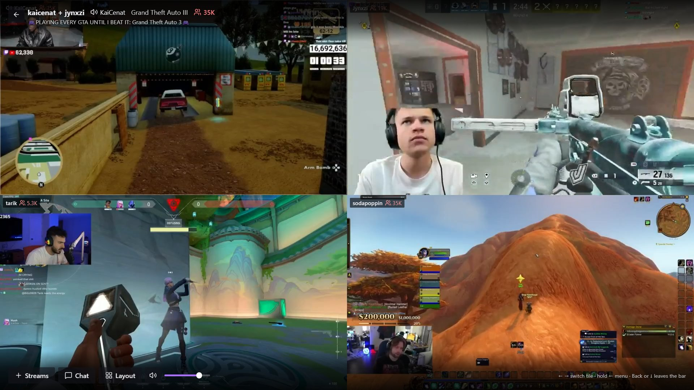
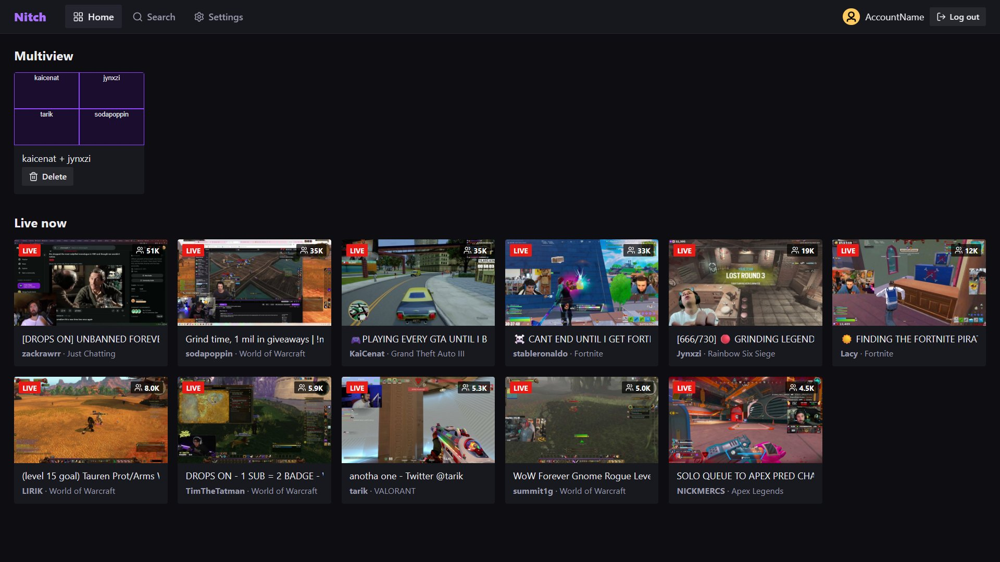
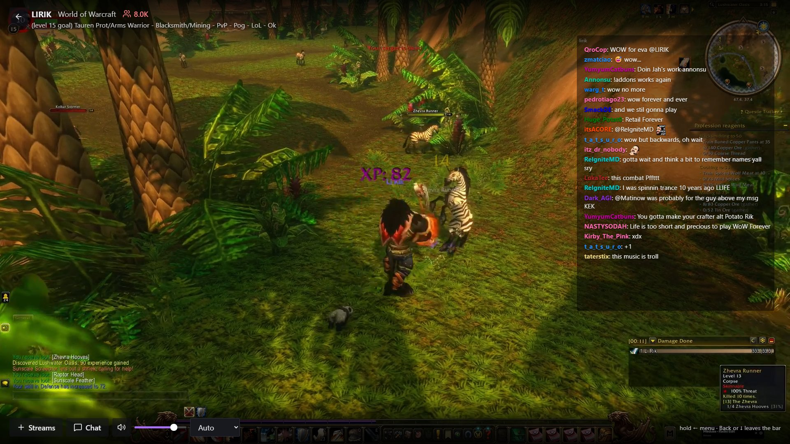
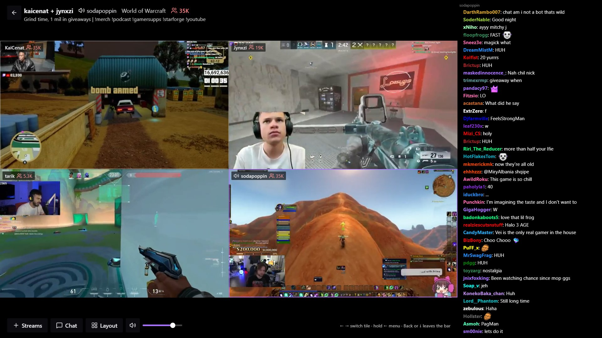
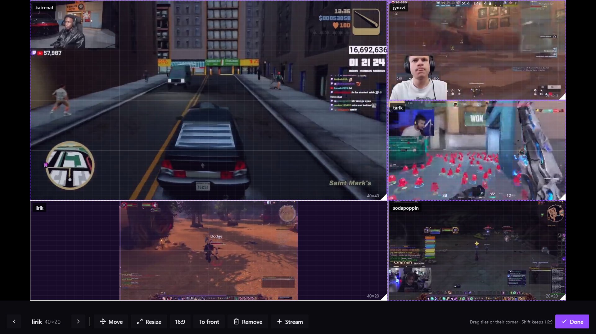
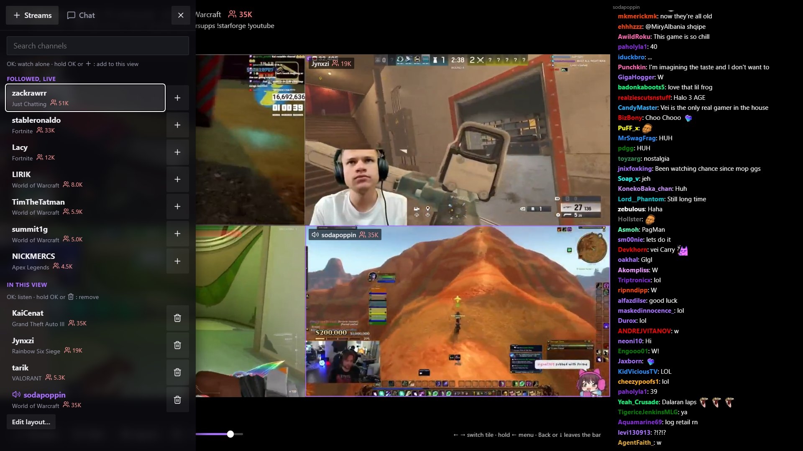
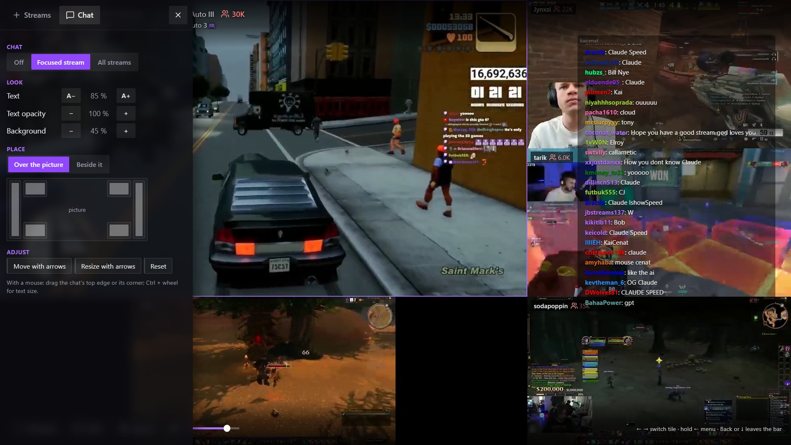

# Nitch

A self-hosted Twitch viewer for desktop browsers and Android TV, built around multiview.

A small server runs at home (one Docker container). It logs in to Twitch once, serves the web app
and merges several live streams into a single video, so even a weak TV stick can play a 2×2
multiview with chat next to it.



## Features

**Watching**
- Followed channels that are live, with thumbnail, title, game and viewer count
- Channel search
- Full-screen player with quality choice and volume; switching channels keeps the old stream
  playing until the new one is ready

**Multiview**
- Up to 9 streams in one view, merged into a single video on the server: the device plays one
  stream, whatever its hardware
- Add streams while watching from the side menu: search, followed channels, and recommendations
  from the `@mentions` in the stream titles
- Free layout: move and resize tiles over the running picture (mouse or remote); each tile keeps
  its picture centered at 16:9
- The focused tile has the sound; switching is instant
- Every tile reads the smallest stream quality that fits its size
- Layouts are saved on the server and look the same on every device
- Hardware encoding with VA-API, software encoding (x264) everywhere else

**Chat**
- Read-only chat of the focused stream, or several streams combined with a color per channel
- Over the picture anywhere on the screen (quick places, move and resize) or beside the picture,
  where it uses space a 16:9 stream leaves empty
- Text size, text opacity and background, saved per device
- Followed channels open with the messages written before

**Android TV**
- A small app that finds the server on the network and shows the same web app, so it updates
  with the server
- Made for the remote: arrow navigation by rows, hold ← for the side menu, Back, Play/Pause

**At home**
- One Docker container; the Twitch login happens once, by phone (device code and QR code)
- Every device in the network uses it without its own login

## Screenshots

| | |
|---|---|
|  |  |
| Home: saved multiviews and live channels | A single stream with the chat over the picture |
|  |  |
| Multiview with the chat beside the picture | Editing a custom layout over the running picture |
|  |  |
| The side menu: add streams while watching | The side menu: chat look and place |

## Quick start

1. Register a Twitch app, copy `.env.example` to `.env` and fill in its Client ID and secret.
2. Start it (the image comes from Docker Hub, `slopimade/nitch`):

   ```bash
   docker compose -f deploy/compose.yaml up -d
   ```

3. Open `http://<server>:8080` and log in with your phone.
4. On the TV: install the APK from the [latest release](https://github.com/SlopIMade/Nitch/releases/latest).

Full guide (Twitch app, options, hardware encoding, TV app): [docs/INSTALL.md](docs/INSTALL.md).
Development setup: [docs/DEVELOPMENT.md](docs/DEVELOPMENT.md).

## Docs

- [Architecture](docs/ARCHITECTURE.md): components, playback paths, multiview pipeline, API
- [Roadmap](docs/ROADMAP.md): milestones, open questions, risks
- [Decisions](docs/DECISIONS.md): what was chosen and why
- [Install](docs/INSTALL.md): Twitch app, configuration, Docker, the TV app
- [Development setup](docs/DEVELOPMENT.md): tools and checks

## Layout

```
server/       Rust workspace: nitch-server (API, web app, multiview manager, chat),
              nitch-twitch, nitch-hls (playlists), nitch-media (GStreamer pipelines)
web/          React + TypeScript + Vite single-page app
android-tv/   Kotlin WebView shell for Android TV
deploy/       Dockerfile, compose files
docs/         Architecture, roadmap, decisions, install and development guides
spikes/       Early experiments, each with FINDINGS.md
scripts/      Development environment setup and checks
```

## Disclaimer

Nitch is an unofficial project and is not affiliated with or endorsed by Twitch. Use it at your
own risk.
